  

### 🚀 Core Engineering & Architecture

<table>
<tr>
<td width="33%" valign="top">

#### ⚡ Systems & Languages
- Compilers & language design (**Rust**)
- Low-latency system engineering
- Memory-safe core architectures

</td>
<td width="33%" valign="top">

#### 🌐 Full-Stack & Desktop
- Scalable microservices & REST APIs
- Cross-platform desktop apps (**Electron**)
- Modern UI/UX with **TypeScript & React**

</td>
<td width="33%" valign="top">

#### 🛠️ Cloud & DevOps
- Container orchestration with **Docker**
- Automated CI/CD pipelines & reverse proxies (**Caddy**)
- Linux system internals & server administration

</td>
</tr>
</table>

<h3 align="center">🛠️ Tech Stack & Toolbelt</h3>

  <b>Languages & Runtimes:</b> 
  

  <b>Frameworks, Storage & Frontend:</b> 
  

  <b>DevOps, Infrastructure & Workflow:</b> 
  

<h3 align="center">🌟 Featured Repositories</h3>

| Project | Focus | Tech Stack | Highlights |
| :--- | :--- | :--- | :--- |
| **[Nova](https://github.com/Chandan-p-l/Nova)** | Systems & Language Design | `Rust` | Custom language architecture with formal grammar specs and lexer/parser design. |
| **[Lumina_Vault](https://github.com/Chandan-p-l/Lumina_Vault)** | Secure Desktop & Client/Server | `TypeScript` · `Electron` · `React` | Modular enterprise desktop application featuring client-server architecture. |
| **[VPS_pannel](https://github.com/Chandan-p-l/VPS_pannel)** | Cloud Infrastructure & DevOps | `Docker` · `Caddy` · `Node.js` | Containerized VPS server management control panel with automated reverse proxy. |
| **[omnidrive](https://github.com/Chandan-p-l/omnidrive)** | Distributed Cloud Storage | `TypeScript` · `Docker` | Unified multi-cloud storage manager with agent support and decoupled architecture. |
| **[DriveDock](https://github.com/Chandan-p-l/DriveDock)** | Developer Automation | `Shell` · `JavaScript` | Zero-friction CLI utility with one-command installation and daemon management. |
| **[linux-developer-handbook](https://github.com/Chandan-p-l/linux-developer-handbook)** | Linux Engineering Documentation | `Shell` · `MkDocs` | Comprehensive engineering handbook for Linux internals, automation, and tooling. |

<h3 align="center">📈 Engineering Metrics</h3>

 
<i>"Crafting resilient systems, high-leverage developer tools, and clean architectures."</i>
  

